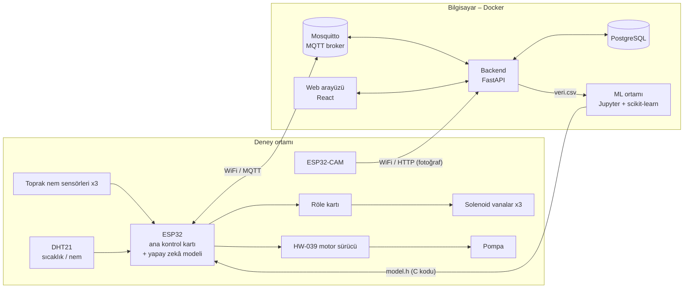

# Yapay Zekâ Destekli Akıllı Sulama Sistemi – Yazılım Geliştirme Planı ve Görev Dağılımı

Bu belge projenin yazılım kısmını kimin, hangi sırayla ve hangi araçlarla yapacağını anlatır.
Proje tanımı için bkz. [docs/proje-tanimi.pdf](docs/proje-tanimi.pdf).

---

## 1. Sistem nasıl çalışıyor?



1. ESP32 her dakika sensörleri okur ve ölçümleri **MQTT** ile bilgisayara gönderir.
2. ESP32-CAM her 30 dakikada marulun fotoğrafını çekip **HTTP** ile backend'e yükler. Backend fotoğraftaki yeşil alan oranını hesaplar.
3. Backend tüm verileri **PostgreSQL** veritabanına kaydeder. Web arayüzü bu verileri gösterir.
4. Toplanan verilerle bilgisayarda bir **karar ağacı** modeli eğitilir. Model otomatik olarak C koduna (`model.h`) çevrilip ESP32'ye yüklenir.
5. ESP32, modelin kararına göre ilgili saksının vanasını açar. Pompa hızını açık vana sayısına göre ayarlar.

> **Önemli tasarım kararı:** Sulama kararını bilgisayar değil ESP32 verir. Bilgisayar kapansa ya da WiFi kopsa bile bitkiler sulanmaya devam eder.

---

## 2. Kullanılacak teknolojiler

| Katman | Teknoloji | Neden seçildi |
|---|---|---|
| Mikrodenetleyici yazılımı | C++ (Arduino çatısı), **PlatformIO** (VS Code eklentisi) | Arduino kütüphaneleri kullanılır, kütüphaneler otomatik indirilir |
| Cihaz ↔ sunucu iletişimi | **MQTT** (Mosquitto broker) | IoT cihazları için hafif ve standart mesajlaşma yöntemi |
| Fotoğraf yükleme | HTTP POST | Fotoğraflar MQTT için fazla büyük |
| Backend | **Python 3.12, FastAPI**, SQLAlchemy, paho-mqtt, Pillow | Öğrenmesi kolay; API belgesi kendiliğinden oluşur |
| Veritabanı | **PostgreSQL 16** | Zaman serisi veriler için güvenilir |
| Web arayüzü | **React + Vite**, Recharts (grafik) | Bileşen tabanlı, hızlı geliştirme |
| Makine öğrenmesi | **scikit-learn** (karar ağacı), pandas, Jupyter Lab | Karar ağacı ESP32 belleğine sığacak kadar küçük ve açıklanabilir |
| Çalıştırma ortamı | **Docker Desktop + Docker Compose** | Herkesin bilgisayarında aynı ortam, tek komutla kurulum |
| Sürüm kontrolü | **Git + GitHub** | Ortak çalışma ve yedekleme |

---

## 3. Klasör yapısı ve sorumlular

| Klasör | İçerik | Sorumlu |
|---|---|---|
| `firmware/esp32-controller/` | Ana ESP32 yazılımı (sensör, röle, pompa, model) | **Öğrenci A** |
| `firmware/esp32-cam/` | Kamera yazılımı | **Öğrenci C** |
| `backend/` | API, MQTT köprüsü, veritabanı, görüntü analizi | **Öğrenci B** (görüntü analizi dosyası `goruntu_analiz.py`: **Öğrenci C**) |
| `frontend/` | Web arayüzü | **Öğrenci B** |
| `simulator/` | Donanım yokken sahte veri üreten sanal ESP32 | **Öğrenci B** |
| `ml/` | Veri indirme, model eğitimi, C koduna çevirme | **Öğrenci C** |
| `docker-compose.yml`, `mosquitto/` | Docker ayarları | **Öğrenci B** |
| `docs/` | Proje belgeleri, deney kayıtları | Herkes |

---

## 4. Roller

Görevler, her öğrencinin bir alanın **sahibi** olacağı şekilde dağıtılmıştır. İş yükleri birbirine yakındır: A donanım ağırlıklı, B yazılım ağırlıklı, C veri ve yapay zekâ ağırlıklı çalışır. Ortak işler (kurulum, deney nöbeti, rapor) üç kişiye eşit bölünmüştür.

| Rol | Kısaca sorumluluğu |
|---|---|
| **Öğrenci A – Gömülü Sistemler ve Donanım** | Devre kurulumu, sensör kalibrasyonu, ana ESP32 yazılımı, vana ve pompa kontrolü, modelin ESP32'de çalıştırılması |
| **Öğrenci B – Backend, Web ve Docker** | Sunucu tarafı, veritabanı, web arayüzü, Docker ortamının bakımı, simülatör |
| **Öğrenci C – Veri, Görüntü ve Yapay Zekâ** | ESP32-CAM, görüntü analizi, deney veri planı, model eğitimi ve değerlendirmesi |

> Rollerin hangi öğrenciye verileceğini öğretmen belirler. İsimler buraya yazılabilir:
> A: ………………  B: ………………  C: ………………

---

## 5. Docker kullanım rehberi (herkes okumalı)

### 5.1 Docker nedir, bize ne sağlar?

Docker, programları **konteyner** denen yalıtılmış kutular içinde çalıştırır. Bu projede veritabanı, MQTT broker, backend, web arayüzü ve Jupyter ayrı konteynerlerde çalışır. Hiçbirini bilgisayara ayrıca kurmanız gerekmez. Python, Node.js ve PostgreSQL kurulumu yoktur. Hangi konteynerin nasıl çalışacağı `docker-compose.yml` dosyasında yazılıdır. Herkesin bilgisayarında **aynı** ortam oluşur.

Kavramlar:
- **İmaj (image):** Programın paketlenmiş hâli (örn. `postgres:16-alpine`).
- **Konteyner (container):** İmajın çalışan kopyası (örn. `sulama-db`).
- **Volume:** Konteyner silinse bile verinin saklandığı alan (veritabanı ve fotoğraflar burada).
- **Profil:** İsteğe bağlı servisler. `sim` simülatörü, `ml` Jupyter'i açar.

### 5.2 Kurulum (her öğrenci, bir kez)

1. **Git** kurun: https://git-scm.com/download/win
2. **Docker Desktop** kurun: https://www.docker.com/products/docker-desktop/. Kurulumda "Use WSL 2" seçili olsun. Bilgisayarı yeniden başlatın. Docker Desktop'u açın ve sol altta "Engine running" yazısını bekleyin.
3. **VS Code** kurun ve şu eklentileri ekleyin: *Docker*, *Python*, *PlatformIO IDE* (sadece A ve C için).
4. Projeyi indirin (PowerShell'de):
   ```powershell
   cd Desktop
   git clone https://github.com/furkanatlan/gulsum-oz-tubitak.git
   cd gulsum-oz-tubitak
   copy .env.example .env
   ```
5. Sistemi simülatörle başlatın (ilk seferde imajlar indirildiği için 5-10 dakika sürer):
   ```powershell
   docker compose --profile sim up -d --build
   ```
6. Kontrol edin:
   - Web arayüzü: http://localhost:5173. Saksı kartlarında nem değerleri birkaç saniyede bir değişmelidir.
   - API belgesi: http://localhost:8000/docs
   - Docker Desktop → *Containers* sekmesinde `sulama-*` konteynerleri yeşil görünmelidir.

### 5.3 Günlük kullanılan komutlar

Bütün komutlar proje klasöründe (`gulsum-oz-tubitak`) çalıştırılır.

| Ne yapmak istiyorum? | Komut |
|---|---|
| Sistemi başlat | `docker compose up -d` |
| Simülatörle birlikte başlat | `docker compose --profile sim up -d` |
| Jupyter (ML) ile birlikte başlat | `docker compose --profile ml up -d` |
| Çalışan konteynerleri gör | `docker compose ps` |
| Bir servisin kayıtlarını (log) izle | `docker compose logs -f backend` (çıkış: `Ctrl+C`) |
| `requirements.txt` / `package.json` / `Dockerfile` değişti, yeniden derle | `docker compose up -d --build` |
| Bir servisi yeniden başlat | `docker compose restart backend` |
| Simülatörü durdur | `docker compose stop simulator` |
| Gelen MQTT mesajlarını canlı izle | `docker compose exec mqtt mosquitto_sub -t "sulama/#" -v` |
| Veritabanına bağlan (SQL yazmak için) | `docker compose exec db psql -U sulama` (çıkış: `\q`) |
| Sistemi durdur (veriler korunur) | `docker compose --profile sim --profile ml down` |

> ⚠️ **`docker compose down -v` komutunu kullanmayın.** `-v`, veritabanını ve fotoğrafları kalıcı olarak siler. Deney süresince bu komut yasaktır.

**Kod değiştirince yeniden başlatmak gerekir mi?** Hayır. `backend/app` ve `frontend` klasörleri konteynere bağlıdır. Dosyayı kaydettiğinizde backend kendiliğinden yeniden başlar ve web sayfası kendiliğinden yenilenir. Yalnızca yeni bir kütüphane eklediğinizde `--build` gerekir.

### 5.4 Veritabanı yedeği (deney süresince haftada bir – Öğrenci B)

```powershell
docker compose exec db pg_dump -U sulama -f /tmp/yedek.sql sulama
docker compose cp db:/tmp/yedek.sql ./yedek_TARIH.sql
```
Yedek dosyasını Google Drive gibi bir yere de kopyalayın. Yedek dosyaları git'e eklenmez.

### 5.5 Gerçek ESP32'yi Docker'a bağlamak (Öğrenci A ve C)

ESP32, bilgisayarın içindeki Docker'a WiFi üzerinden bağlanır. Bunun için:

1. Bilgisayar ile ESP32 **aynı WiFi ağında** olmalı.
2. Bilgisayarın IP adresini öğrenin: PowerShell'de `ipconfig`. "Wireless LAN adapter Wi-Fi" altındaki **IPv4 Address** değerini (örn. `192.168.1.35`) alın.
3. Bu adresi `firmware/.../include/secrets.h` içine yazın.
4. ESP32 bağlanamıyorsa Windows Güvenlik Duvarı'nda portları açın (PowerShell'i **yönetici olarak** açın):
   ```powershell
   New-NetFirewallRule -DisplayName "Akilli Sulama" -Direction Inbound -Protocol TCP -LocalPort 1883,8000 -Action Allow
   ```
5. Gerçek ESP32 çalışırken **simülatörü durdurun** (`docker compose stop simulator`). Yoksa sahte veri gerçek veriye karışır.

### 5.6 Sık karşılaşılan hatalar

| Hata | Çözüm |
|---|---|
| `error during connect ... dockerDesktopLinuxEngine` | Docker Desktop açık değil. Açın ve "Engine running" yazısını bekleyin. |
| `port is already allocated` | Başka bir program aynı portu kullanıyor. `.env` dosyasındaki `..._PORT_DIS` değerini değiştirin (örn. `WEB_PORT_DIS=5180`). |
| `env file .env not found` | `copy .env.example .env` komutunu çalıştırın. |
| Web arayüzünde "Bağlantı hatası" | `docker compose logs backend` ile hatayı okuyun. |
| Konteyner sürekli yeniden başlıyor | `docker compose logs <servis>` çıktısının son satırlarına bakın. |

---

## 6. Git ile birlikte çalışma kuralları

1. Çalışmaya başlamadan önce son hâli alın: `git pull`
2. Her görev için ayrı bir dal (branch) açın: `git checkout -b a/nem-kalibrasyonu`. Dal adı rol harfiyle başlar.
3. Küçük ve anlamlı commit'ler atın: `git commit -m "Nem sensörü kalibrasyon değerleri eklendi"`
4. Dalı gönderin (`git push -u origin a/nem-kalibrasyonu`). GitHub'da **Pull Request** açın. **Diğer iki öğrenciden biri** inceleyip onaylasın, sonra `main` dalına birleştirilsin.
5. `.env` ve `secrets.h` dosyaları WiFi şifresi içerdiği için **asla** git'e eklenmez (`.gitignore` bunu engeller).

Her öğrenci ağırlıklı olarak kendi klasöründe çalıştığı için çakışma (conflict) az olur. Başkasının klasöründe değişiklik gerekiyorsa önce o kişiye haber verin.

---

## 7. Bileşenler arası sözleşme

Bu bölüm, farklı öğrencilerin yazdığı parçaların birbirini anlaması için uyulması **zorunlu** kurallardır. Değişiklik yapılacaksa üç kişi birlikte karar verir ve bu tablo güncellenir.

### 7.1 MQTT mesajları

| Konu (topic) | Yön | Örnek içerik (JSON) |
|---|---|---|
| `sulama/telemetri` | ESP32 → sunucu, dakikada bir | `{"cihaz":"esp32-ana","sicaklik":24.1,"hava_nem":55.0,"saksilar":[{"saksi":1,"toprak_nem":41.5,"ham":2100,"vana":false}, …]}` |
| `sulama/olay` | ESP32 → sunucu, her sulama bitince | `{"saksi":1,"sure_sn":9.4,"su_ml":150,"kaynak":"model"}`. `kaynak`: `model` / `kural` / `manuel` |
| `sulama/komut` | sunucu → ESP32 | `{"islem":"sula","saksi":2,"sure_sn":5}` veya `{"islem":"mod","mod":"manuel"}` |
| `sulama/bitki_indeksi` | sunucu → ESP32 | `{"saksi":1,"yesil_oran":0.34}` |

Saksı numaraları sabittir: **1 = kumlu, 2 = killi, 3 = tinli.**

### 7.2 Model girdileri (sırası değişmez)

`x[0]` toprak nemi (%), `x[1]` sıcaklık (°C), `x[2]` hava nemi (%), `x[3]` toprak kodu (0 kumlu, 1 killi, 2 tinli), `x[4]` yeşil oran (0–1), `x[5]` son sulamadan beri geçen dakika (en fazla 1440).
Bu sıra `ml/src/ozellikler.py` ve `firmware/esp32-controller/src/main.cpp` (`modelGirdisiHazirla`) içinde aynı olmalıdır.

### 7.3 Backend API

Tam liste ve deneme ekranı: http://localhost:8000/docs. Başlıcaları: `GET /api/saksilar/ozet`, `GET /api/olcumler`, `GET /api/sulama/olaylar`, `POST /api/sulama/manuel`, `POST /api/sulama/mod`, `POST /api/goruntuler/yukle`, `GET /api/disa-aktar/veri.csv`.

---

## 8. Geliştirme adımları (sırasıyla)

Adımlar sırayla ilerler. **Adım 2'de üç öğrenci aynı anda, birbirini beklemeden** çalışır. Bunu mümkün kılan simülatördür: donanım hazır olmadan backend, web ve ML tarafı gerçeğe uygun sahte veriyle geliştirilebilir.

### Adım 1 – Ortam kurulumu ve sistemi tanıma (Herkes · ~1 hafta)

- [ ] Bölüm 5.2'deki kurulumu yapın, sistemi simülatörle çalıştırın.
- [ ] Web arayüzünden "5 sn sula" düğmesine basın. `docker compose logs -f simulator` çıktısında sulamanın gerçekleştiğini görün.
- [ ] MQTT mesajlarını `mosquitto_sub` komutuyla izleyin (Bölüm 5.3).
- [ ] http://localhost:8000/docs adresinden birkaç API'yi deneyin.
- [ ] Her öğrenci kendi klasöründeki kodu okuyup anlamadığı yerleri not alsın. Not alınan konular ortak bir toplantıda konuşulsun.
- [ ] Her öğrenci deneme olarak bir dal açıp küçük bir değişiklik yapsın ve Pull Request göndersin (Bölüm 6).

**Bitti sayılır:** Üç bilgisayarda da web arayüzü canlı veri gösteriyor ve herkes bir PR açmış.

### Adım 2 – Bileşenlerin geliştirilmesi (paralel · ~3 hafta)

#### Öğrenci A – Donanım ve ana ESP32
- [ ] Devreyi kurun. ESP32, röle kartı ve motor sürücünün GND'leri ortak olmalıdır. 12V hattı ESP32'ye doğrudan bağlanmaz; ESP32 5V çevirici üzerinden beslenir.
- [ ] `firmware/esp32-controller` klasörünü VS Code'da PlatformIO ile açın. `secrets.example.h` dosyasını `secrets.h` adıyla kopyalayın. Derleyip (✓ simgesi) yükleyin (→ simgesi). Seri monitörden çıktıları izleyin.
- [ ] Her nem sensörü için kalibrasyon yapın: havada ve suda okunan ham değerleri `config.h` içindeki `NEM_KURU` / `NEM_ISLAK` dizilerine yazın.
- [ ] Röle kartının LOW mu HIGH mı ile çektiğini test edip `ROLE_AKTIF` değerini doğrulayın.
- [ ] Vanaları ve pompayı tek tek test edin. 1, 2 ve 3 vana açıkken uygun pompa hızlarını bulup `POMPA_HIZI` dizisine yazın.
- [ ] ESP32'yi Docker'daki MQTT'ye bağlayın (Bölüm 5.5). Web arayüzünde gerçek nem değerlerini görün.

**Bitti sayılır:** Web arayüzünden basılan "sula" düğmesi gerçek vanayı açıyor, süre dolunca kapatıyor ve olay web'de listeleniyor.

#### Öğrenci B – Backend, web arayüzü ve Docker
- [ ] Web arayüzüne her saksı için son 24 saatin toprak nemi grafiğini ekleyin (Recharts, `SaksiKarti.jsx`).
- [ ] Sıcaklık / hava nemi grafiği ve günlük toplam su tüketimi grafiği ekleyin (backend'e gerekli API'yi yazın).
- [ ] Her saksı için fotoğraf geçmişi (galeri) sayfası ekleyin.
- [ ] Manuel sulama süresinin kullanıcı tarafından girilebilmesini ve otomatik/manuel modun ekranda gösterilmesini sağlayın.
- [ ] ESP32'den belirli bir süre veri gelmezse arayüzde "cihaz bağlantısı yok" uyarısı gösterin.
- [ ] Simülatörü gerçekçi tutun: yeni bir MQTT mesajı eklenirse simülatöre de ekleyin.

**Bitti sayılır:** PDF'te istenen tüm göstergeler (toprak nemi, sıcaklık, bitki görüntüleri, sulama durumu, kullanılan su miktarı) web arayüzünde görünüyor.

#### Öğrenci C – Kamera, görüntü analizi ve veri planı
- [ ] `firmware/esp32-cam` yazılımını ESP32-CAM'e yükleyin (yükleme için USB-TTL dönüştürücü ya da ESP32-CAM-MB kartı gerekir). Fotoğrafların web arayüzünde göründüğünü doğrulayın.
- [ ] Kamera açısını, ışığı ve çözünürlüğü sabitleyin. Fotoğraflar her gün aynı koşulda çekilmeli.
- [ ] `backend/app/goruntu_analiz.py` içindeki yeşil eşiklerini gerçek marul fotoğraflarıyla ayarlayın. Eşiklerin doğru olduğunu birkaç örnek fotoğrafın maskesini çizerek (Jupyter) gösterin.
- [ ] Deney veri planını `docs/deney_protokolu.md` dosyasına yazın. Planda şunlar olsun: hangi koşulda sulama yapılacağı (başlangıç kuralı), hangi gözlemlerin elle not edileceği (solgunluk, yaprak rengi vb.) ve kaç gün veri toplanacağı.
- [ ] Simülatör verisiyle `ml/src/egit.py` akışını uçtan uca çalıştırıp çıktıyı yorumlayın (Adım 5'in provası).

**Bitti sayılır:** Fotoğraflar otomatik geliyor, yeşil oran mantıklı değerler veriyor, deney protokolü üç kişi tarafından onaylandı.

### Adım 3 – Entegrasyon ve kalibrasyon (Herkes · ~1 hafta)

- [ ] **Pompa debisi kalibrasyonu (A + C):** Her pompa hızı için vanayı 60 sn açın, ölçekli kapta suyu ölçün. Tek vana için ml/sn değerini `config.h` → `DEBI_ML_SN` alanına, ml/dk değerini `.env` → `POMPA_DEBI_ML_DK` alanına yazın.
- [ ] **Uçtan uca test (Herkes):** Simülatör kapalıyken gerçek sensör → MQTT → veritabanı → web akışını ve web → vana akışını birlikte test edin.
- [ ] **Dayanıklılık testi (A + B):** WiFi'yi kapatıp açın, bilgisayarı yeniden başlatın. ESP32'nin kendiliğinden yeniden bağlandığını ve bağlantı yokken de sulamaya devam ettiğini doğrulayın.
- [ ] **Deney bilgisayarı (B):** Deney boyunca açık kalacak bir bilgisayar belirleyin. Uyku modunu kapatın. Docker Desktop'un Windows açılışında başlamasını ayarlayın (Settings → General → *Start Docker Desktop when you sign in*).

**Bitti sayılır:** Sistem 48 saat boyunca kesintisiz veri topluyor.

### Adım 4 – Veri toplama deneyi (Herkes · marulun büyüme süresi boyunca, ~4-6 hafta)

- [ ] Marullar üç toprak türüne ekilir. Sistem **"kural"** modunda çalışır: geçici `model.h` dosyası, nem %35'in altına düşünce sular. Bu eşik Öğrenci C'nin protokolüne göre güncellenebilir.
- [ ] Nöbet çizelgesi: Her gün bir öğrenci sisteme bakar. Gözlemleri (bitkinin durumu, sorunlar, elle yapılan sulamalar) `docs/deney_gunlugu.md` dosyasına yazar.
- [ ] Öğrenci B haftalık veritabanı yedeği alır (Bölüm 5.4).
- [ ] Öğrenci C her hafta `veri.csv` dosyasını indirir. Veriyi Jupyter'de grafiklerle inceler, eksik veya hatalı ölçüm olup olmadığını kontrol eder ve sonuçları ekiple paylaşır.
- [ ] Öğrenci A, sensörlerde kayma ya da arıza olursa yeniden kalibrasyon yapar ve tarihini günlüğe yazar.

**Bitti sayılır:** Her toprak türü için en az birkaç yüz ölçüm ve onlarca sulama olayı birikmiş.

### Adım 5 – Model eğitimi ve ESP32'ye aktarma (C ana sorumlu, A destek · ~1-2 hafta)

- [ ] **(C)** Jupyter'i açın: `docker compose --profile ml up -d` → http://localhost:8888
- [ ] **(C)** Veriyi indirin: `docker compose exec ml python src/veri_indir.py`
- [ ] **(C)** Etiketleme yöntemini (`ml/src/ozellikler.py`) deney gözlemlerine göre gözden geçirin. Farklı ağaç derinliklerini deneyin. Doğruluk, hassasiyet ve su miktarı hatasını raporlayın. Hangi özelliğin kararda en etkili olduğunu (feature importance) gösterin.
- [ ] **(C)** Modeli üretin: `docker compose exec ml python src/egit.py`. Komut `firmware/esp32-controller/include/model.h` dosyasının üzerine eğitilmiş modeli yazar.
- [ ] **(A)** Yeni `model.h` ile ESP32 yazılımını derleyip yükleyin. Seri monitörde ve web arayüzünde sulama kaynağının artık `model` olarak göründüğünü doğrulayın.
- [ ] **(A + C)** Masa başı test: Sensörü kuru / ıslak toprağa koyarak modelin beklenen kararları verdiğini kontrol edin.

**Bitti sayılır:** ESP32, eğitilmiş modelle otomatik sulama yapıyor.

### Adım 6 – Karşılaştırmalı test ve değerlendirme (Herkes · ~2 hafta)

- [ ] **(C)** Karşılaştırma deneyini tasarlayın: model ile sulama, klasik sabit aralıklı sulamaya (örn. her gün aynı saatte aynı miktar) karşı.
- [ ] **(B)** Web arayüzüne ya da bir rapor sayfasına "toprak türüne göre toplam su tüketimi" ve "model ile kural karşılaştırması" grafiklerini ekleyin.
- [ ] **(A)** Sistemin enerji ve donanım açısından sorunsuz çalıştığını raporlayın: vana ve pompa arızası, sensör kayması.
- [ ] **(Herkes)** Su tasarrufu oranını ve bitki gelişimini (yeşil oran eğrileri) toprak türlerine göre yorumlayın.

### Adım 7 – Raporlama ve sunum (Herkes · ~1 hafta)

Her öğrenci kendi alanının bölümünü yazar. A: donanım ve gömülü yazılım. B: sunucu, veritabanı ve arayüz. C: veri, görüntü analizi ve model. Giriş, sonuç ve sunum birlikte hazırlanır. Sunumda canlı demo için simülatör yedek olarak hazır tutulur.

---

## 9. İş yükü özeti

| | Öğrenci A | Öğrenci B | Öğrenci C |
|---|---|---|---|
| **Adım 1** | Kurulum | Kurulum | Kurulum |
| **Adım 2** | Devre, ana ESP32, kalibrasyon | Web grafikleri, API, galeri, uyarılar | ESP32-CAM, görüntü analizi, deney protokolü |
| **Adım 3** | Debi ölçümü, dayanıklılık testi | Dayanıklılık testi, deney bilgisayarı | Debi ölçümü |
| **Adım 4** | Sensör bakımı + nöbet | Yedekleme + nöbet | Haftalık veri analizi + nöbet |
| **Adım 5** | Modeli ESP32'ye yükleme ve test | – | Model eğitimi ve değerlendirmesi |
| **Adım 6** | Donanım değerlendirmesi | Karşılaştırma grafikleri | Karşılaştırma deneyi tasarımı |
| **Adım 7** | Donanım bölümü | Yazılım bölümü | Yapay zekâ bölümü |

Adım 5'te B'nin işi azdır. B bu sürede Adım 6 grafiklerine erken başlar ve arayüzde eksik kalan işleri tamamlar.
